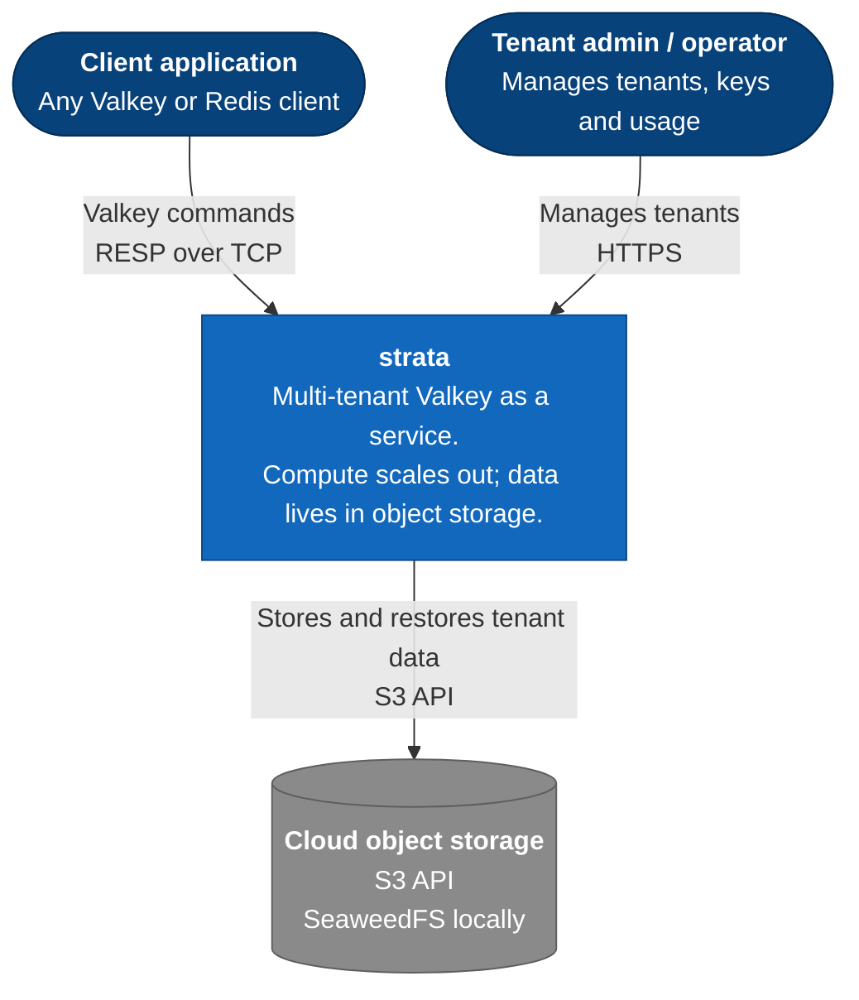

# 1. System context

Who uses strata and what it depends on.

## Elements

| Element | What it is |
|---|---|
| **Client application** | A tenant's program. It uses an ordinary Valkey client library and does not know strata is behind the endpoint. |
| **Tenant admin / operator** | A person (or their automation) who creates tenants, issues credentials and reads usage and health. |
| **strata** | The system in this repo. It accepts Valkey commands, keeps each tenant's data durable, and scales compute by starting more Valkey processes. |
| **Cloud object storage** | The ultimate source of truth for tenant data. It is outside strata: a cloud bucket in production, SeaweedFS (S3 API) in local development. |

## Why it looks like this

- The client side is plain Valkey. Nothing custom is needed to use strata.
- Object storage is the only thing outside the system that must not be lost. Every process inside
  strata can be thrown away and rebuilt from it.
