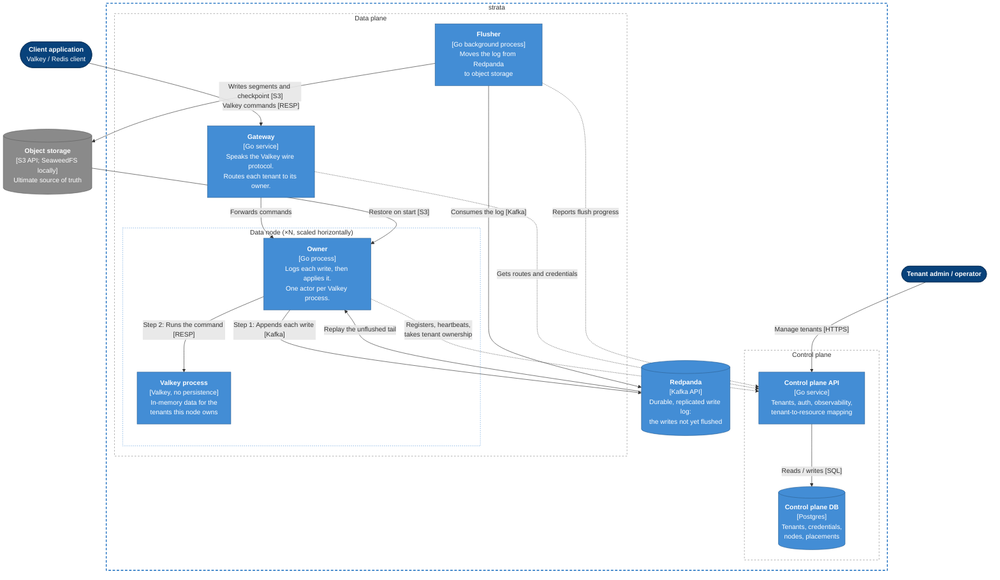

# 2. Containers

The processes and stores inside strata. Solid lines carry tenant data; dashed lines are control
traffic.

## Containers

### Gateway

The single endpoint clients connect to. It speaks the Valkey wire protocol (RESP), works out which
tenant a connection belongs to, and looks up the data node that currently owns that tenant's data.
It then forwards the tenant's commands to that node's owner. The gateway holds no tenant data. Its
tenant-to-owner map is a cache of what the control plane decided, so any number of gateways can run
side by side. Detail: [03-components-gateway.md](03-components-gateway.md).

### Data node: owner + Valkey process

The unit of compute, and the thing that scales horizontally. A data node is two processes that
live and die together:

- **Valkey process.** A stock Valkey server with persistence turned off (no AOF, no RDB). It holds
  the in-memory data of the tenants this node owns, and nothing else talks to it.
- **Owner.** A process attached to that one Valkey process, in the manner of an actor: every
  command for the node's tenants goes through it, in order. For a write it first appends the
  command to Redpanda and, once Redpanda has acknowledged it, runs the command in Valkey. The log
  is therefore always at or ahead of memory, never behind.

A node starts empty. The owner loads a tenant from object storage, replays the writes that are in
Redpanda but not flushed yet, and then starts serving. That is what makes compute disposable.
Detail: [04-components-data-node.md](04-components-data-node.md).

### Redpanda

The durable write log. It gives quick, replicated durability for each write, so strata does not
use Valkey's AOF and does not build its own replication. Redpanda only has to hold the writes that
the flusher has not moved to object storage yet; older log can expire.

### Flusher

A background process that periodically reads the log from Redpanda, packs it into objects, and
writes them to object storage with a checkpoint that records how far it got. After a flush,
object storage alone is enough to rebuild the tenant up to that checkpoint.
Detail: [05-components-flusher.md](05-components-flusher.md).

### Object storage

The ultimate source of truth. If every process and Redpanda itself were lost, the data up to the
last flush would still be here. In the cloud it is a bucket; locally it is SeaweedFS through its
S3 API.

### Control plane API and DB

Everything that is not the data path: tenant accounts and auth, observability, and the SaaS-style
mapping of tenants to resources (which data node owns which tenant). Future control-plane features
that are not business logic of the data path go here too. Its state is in Postgres (assumed; see
the open questions in the [README](README.md)). The data plane keeps serving from cached routes if
the control plane is down; only changes (new tenants, moves) wait.
Detail: [06-components-control-plane.md](06-components-control-plane.md).

## Where the data is at any moment

| Data | Lives in | Lost if that is lost? |
|---|---|---|
| Everything up to the last flush | Object storage | Yes. This is the copy that must survive. |
| Writes since the last flush | Redpanda (replicated) | Only those writes |
| The working copy that serves requests | Valkey memory | No. Rebuilt from the two above. |
| Tenants, credentials, placements | Control plane DB | Control data only, not tenant data |
