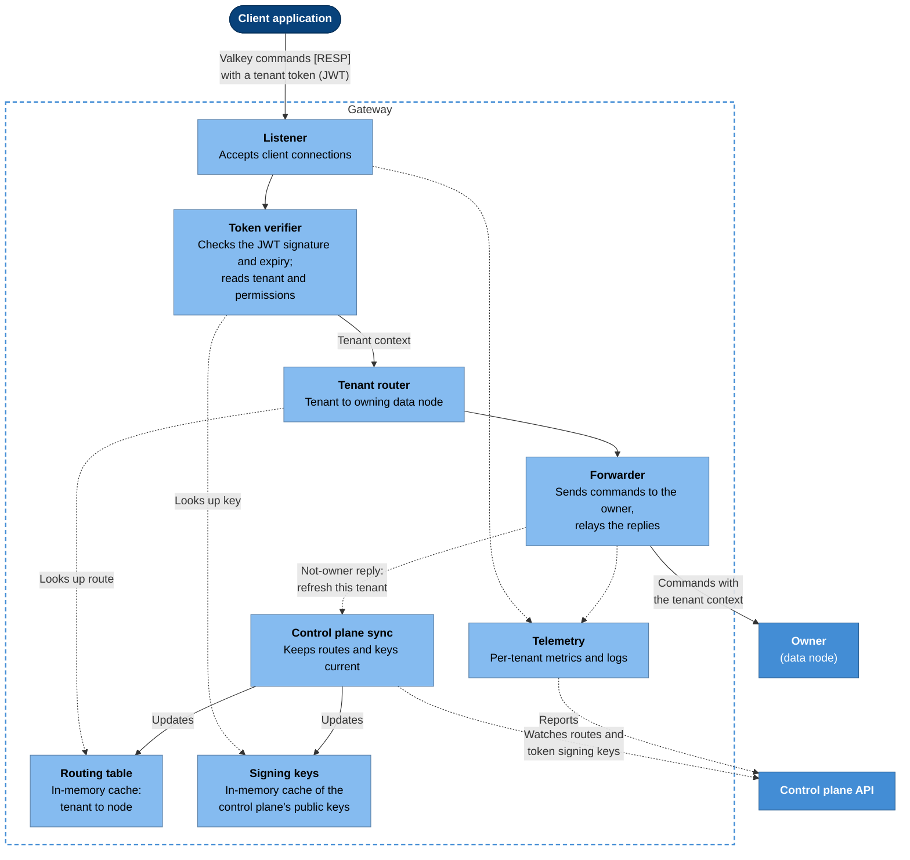

# 3. Components: gateway

Inside the gateway container from [02-containers.md](02-containers.md). The gateway is kept
simple: check the token, find the owner, forward.

## Components

| Component | What it does |
|---|---|
| **Listener** | Accepts client connections and hands each request, with its token, to the token verifier. |
| **Token verifier** | Checks that the tenant token (JWT) was signed by the control plane and has not expired, then reads the tenant and its permissions from the claims. A request with no valid token is refused. It makes no call to the control plane per request. |
| **Tenant router** | Finds the data node that currently owns the tenant's data, using the tenant from the token. This is the tenant mapping the gateway exists for. |
| **Routing table** | The in-memory map of tenant to owning node. It is a cache: the control plane holds the real mapping. |
| **Signing keys** | The control plane's public keys, cached in memory, used to verify tokens. |
| **Control plane sync** | Keeps the routing table and the signing keys current by watching the control plane. It also refreshes one tenant's route on demand when a node says it no longer owns that tenant. |
| **Forwarder** | Sends the commands, with the tenant context from the token, to the owner and relays the replies. It does not interpret the commands. |
| **Telemetry** | Counts and timings per tenant (connections, requests, errors, latency), reported to the control plane for observability. |

## Notes

- **The control plane owns auth; the gateway only checks.** The control plane authenticates the
  tenant and issues the token. The gateway holds no credentials, does no TLS-based tenant lookup
  and does not read Valkey `AUTH` / `HELLO` to work out who the tenant is. The identity and the
  permissions are in the token's claims.
- **The gateway does not interpret Valkey commands.** The owner already has to (to tell a write
  from a read), so that logic lives in one place.
- The gateway never talks to Valkey or Redpanda. It only knows owners.
- It keeps no tenant data and no state that cannot be refetched, so gateways scale out freely
  behind a load balancer.
- When a tenant moves, the old owner answers "not the owner". The gateway refreshes that tenant's
  route and sends what follows to the new owner.
- If the control plane is unreachable, the gateway keeps serving with the routes and keys it has.
  Tokens stay verifiable until they expire.
- How the token travels alongside Valkey commands is an open question; see the
  [README](README.md).
