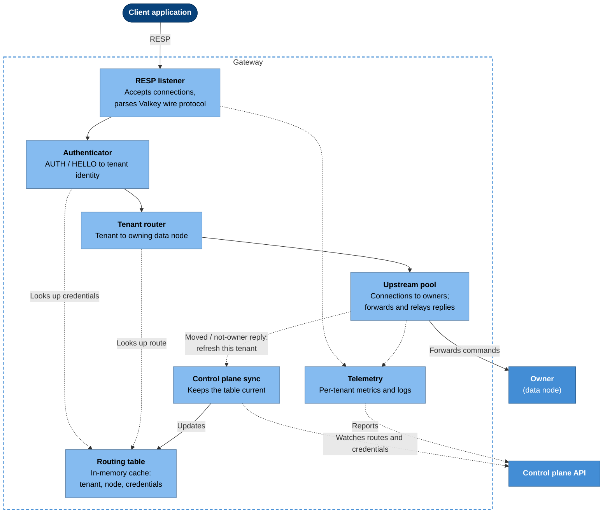

# 3. Components: gateway

Inside the gateway container from [02-containers.md](02-containers.md).

## Components

| Component | What it does |
|---|---|
| **RESP listener** | Accepts client connections and parses the Valkey wire protocol. To the client this is a Valkey server. |
| **Authenticator** | Turns the connection's `AUTH` / `HELLO` into a tenant identity, checked against credentials in the routing table. Commands before a successful auth are refused. |
| **Tenant router** | Finds the data node that currently owns the tenant's data. This is the tenant mapping the gateway exists for. |
| **Routing table** | The in-memory map of tenant to owning node, plus the credentials needed to authenticate. It is a cache: the control plane holds the real mapping. |
| **Control plane sync** | Keeps the routing table current by watching the control plane. It also refreshes one tenant on demand when a node says it no longer owns it. |
| **Upstream pool** | Holds connections to owners, forwards each command to the right one and relays the reply. It keeps a connection's commands in order. |
| **Telemetry** | Counts and timings per tenant (connections, commands, errors, latency), reported to the control plane for observability. |

## Notes

- The gateway never talks to Valkey or Redpanda. It only knows owners.
- It keeps no tenant data and no state that cannot be refetched, so gateways scale out freely
  behind a load balancer.
- When a tenant moves, the old owner answers "not the owner". The pool asks the sync to refresh
  that tenant and retries on the new owner, so a move looks like a short pause to the client.
- If the control plane is unreachable, the gateway keeps serving with the table it has.
