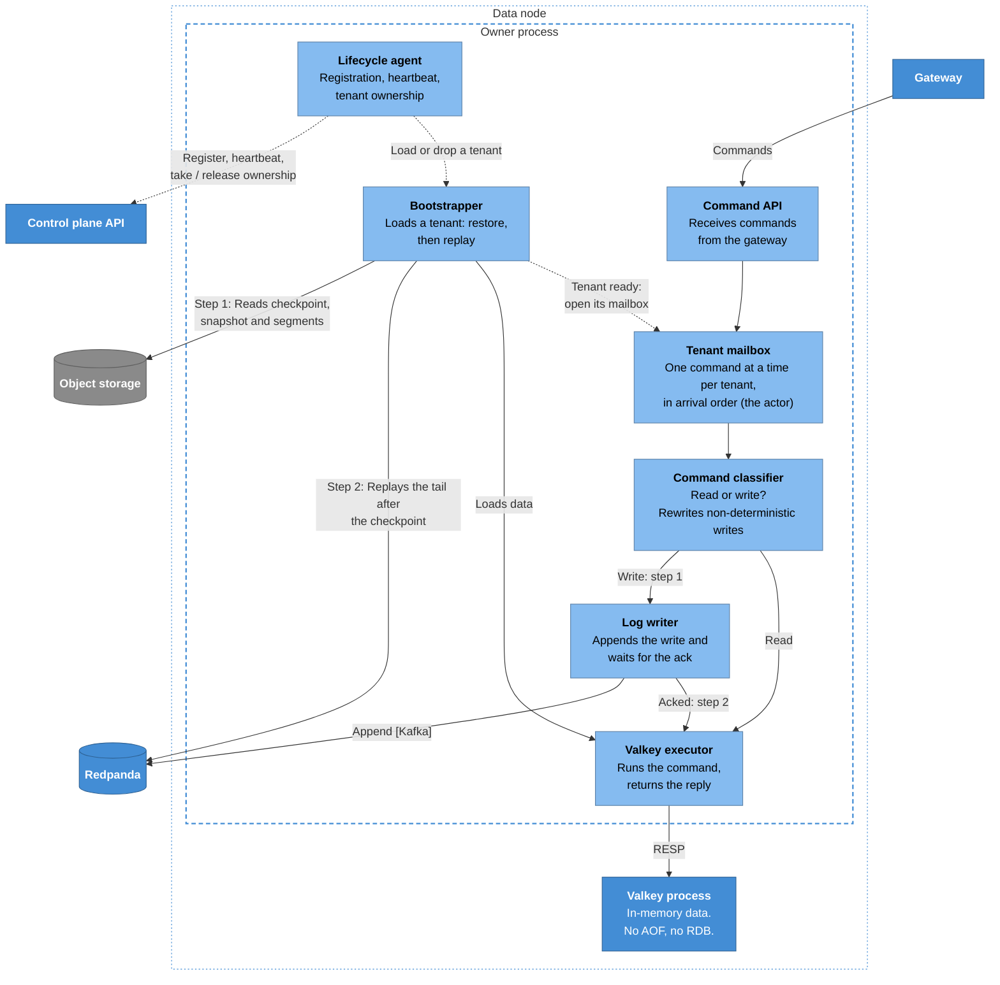

# 3. Components: data node (owner + Valkey process)

Inside one data node from [02-containers.md](02-containers.md). The owner and its Valkey process
are two processes, drawn together because neither is useful alone.

## Components of the owner

| Component | What it does |
|---|---|
| **Command API** | The door the gateway uses. It accepts a tenant's commands and returns their replies. It refuses a tenant this node does not own, so the gateway can refresh its route. |
| **Tenant mailbox** | The actor part. Commands for a tenant are handled one at a time in arrival order, so the order in the log is the order in Valkey. |
| **Command classifier** | Decides whether a command changes data. Reads go straight to the executor. Writes go to the log writer first. It also turns a non-deterministic write into its fixed effect, so a replay gives the same data. |
| **Log writer** | Appends the write to the tenant's log in Redpanda and waits until Redpanda acknowledges it as durable. Only then does the write continue. |
| **Valkey executor** | Runs the command in the Valkey process and passes the reply back. It is the only client the Valkey process has. |
| **Bootstrapper** | Brings a tenant into this node. It reads the tenant's checkpoint and data from object storage, loads that into Valkey, then replays from Redpanda every write after the checkpoint. When it has caught up, the tenant's mailbox opens. |
| **Lifecycle agent** | Registers the node with the control plane, sends heartbeats, and takes or releases ownership of tenants when the control plane says so. |

## The Valkey process

A stock Valkey server, configured with persistence off. It is a fast in-memory working copy and
nothing more: durability is the job of Redpanda and object storage. Only the owner connects to it.

## The write rule

**Log first, then apply.** A write is appended to Redpanda, and only after the acknowledgement is
it run in Valkey and answered to the client.

- A crash before the append: the write did not happen, and the client got no success reply.
- A crash after the append and before the apply: the write is in the log, so the next node that
  loads the tenant replays it. Memory is never ahead of the log.
- This is why Valkey needs no AOF: the Redpanda log plays that role, and it is replicated.

## Why an owner per Valkey process

One writer per Valkey process means one order of writes, with no coordination between nodes on the
data path. Scaling out is adding nodes and moving tenants between them, which the control plane
decides and the lifecycle agent and bootstrapper carry out.
