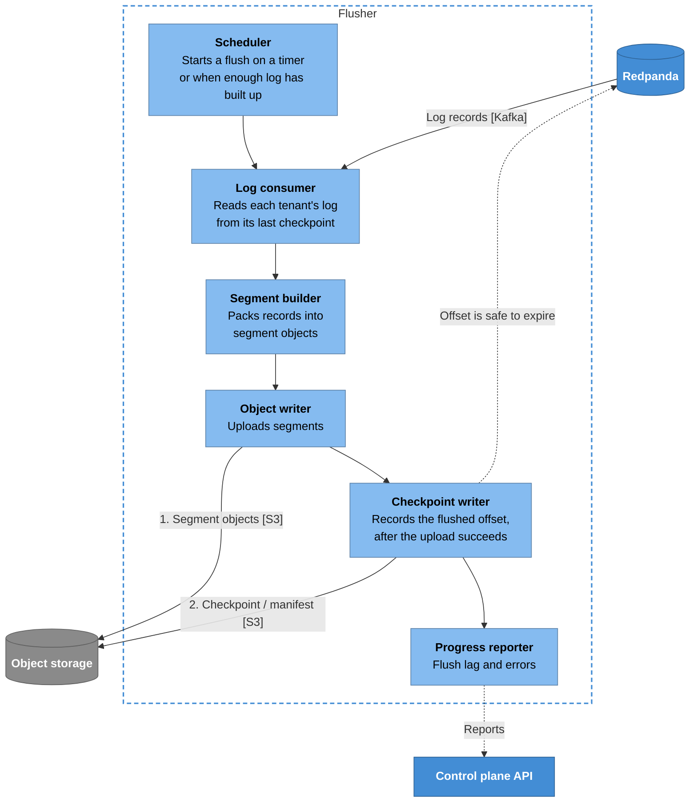

# 3. Components: flusher

Inside the flusher container from [02-containers.md](02-containers.md).

## Components

| Component | What it does |
|---|---|
| **Scheduler** | Decides when to flush: periodically, and sooner when a tenant's unflushed log grows large. |
| **Log consumer** | Reads a tenant's log from Redpanda, starting at the offset in that tenant's last checkpoint. |
| **Segment builder** | Packs the records into segment objects, in log order. Later it can also fold old segments into a snapshot to keep restores fast. |
| **Object writer** | Uploads the segments to object storage. |
| **Checkpoint writer** | After the upload succeeds, writes the tenant's checkpoint: which objects make up the tenant and the last log offset they cover. The checkpoint is what a bootstrapper reads first. |
| **Progress reporter** | Tells the control plane how far behind each tenant's flush is, and about failures. |

## Notes

- **Order matters: segments first, checkpoint second.** A crash between the two leaves extra
  objects that no checkpoint names. The next run flushes the same range again. Nothing is lost
  and nothing is counted twice, because a restore reads only what the checkpoint names.
- The checkpoint is the line between the two stores: object storage is the truth up to that
  offset, and Redpanda holds what comes after. Redpanda may expire log only below it.
- The flusher is not on the request path. If it stops, writes still succeed and stay durable in
  Redpanda; the unflushed tail just grows, and restores take longer.
- The flusher only reads Redpanda and writes object storage. It never touches Valkey.
