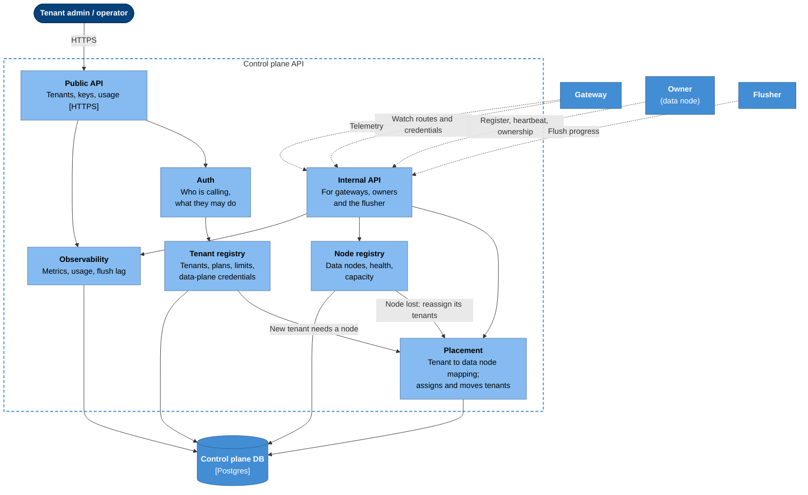

# 3. Components: control plane API

Inside the control plane API container from [02-containers.md](02-containers.md).

## Components

| Component | What it does |
|---|---|
| **Public API** | What tenant admins and operators call: create and remove tenants, issue and revoke keys, read usage and health. |
| **Internal API** | What the data plane calls. Gateways watch routes and credentials; owners register, heartbeat and take ownership; the flusher reports progress. |
| **Auth** | Identifies the caller of the public API and decides what they may do. It also issues the credentials a tenant's clients present to the gateway. |
| **Tenant registry** | The record of each tenant: identity, plan, limits and data-plane credentials. |
| **Node registry** | The record of each data node: address, health from heartbeats, and capacity. |
| **Placement** | The tenant-to-resource mapping. It decides which data node owns each tenant, hands out ownership, and moves tenants when a node is lost, full or drained. The gateway's routing table is a copy of this. |
| **Observability** | Collects metrics and usage from the gateways, owners and flusher, per tenant. |

## Notes

- The control plane is not on the request path. Client commands never pass through it.
- It decides; the data plane does. Placement names the owner of a tenant; the node's lifecycle
  agent and bootstrapper do the loading, and gateways pick up the new route.
- If the control plane is down, existing tenants keep working from cached routes. Creating,
  moving and recovering tenants wait until it is back.
- Starting and stopping data nodes (autoscaling) belongs with Placement and the node registry.
  It is not drawn as its own component yet.
- Control-plane features that are not business logic of the data path belong here as they arrive.
