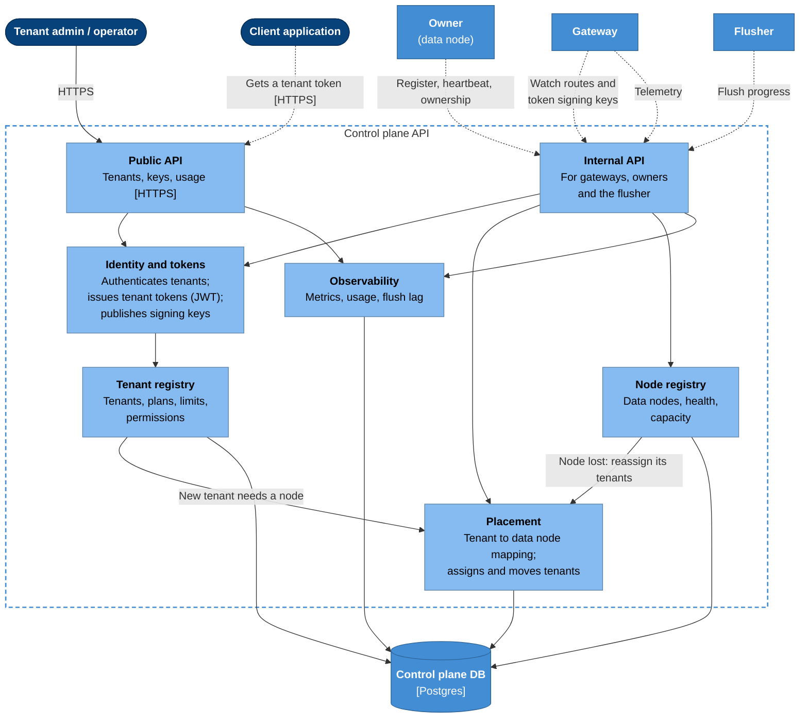

# 3. Components: control plane API

Inside the control plane API container from [02-containers.md](02-containers.md).

## Components

| Component | What it does |
|---|---|
| **Public API** | What tenant admins, operators and client applications call: create and remove tenants, get a tenant token, read usage and health. |
| **Internal API** | What the data plane calls. Gateways watch routes and token signing keys; owners register, heartbeat and take ownership; the flusher reports progress. |
| **Identity and tokens** | The one place auth values are handled. It authenticates a tenant, then issues a signed tenant token (JWT) whose claims carry the tenant's identity and permissions. It publishes the public signing keys so the gateway can verify tokens by itself, and it rotates those keys. |
| **Tenant registry** | The record of each tenant: identity, plan, limits and permissions. The token's claims come from here. |
| **Node registry** | The record of each data node: address, health from heartbeats, and capacity. |
| **Placement** | The tenant-to-resource mapping. It decides which data node owns each tenant, hands out ownership, and moves tenants when a node is lost, full or drained. The gateway's routing table is a copy of this. |
| **Observability** | Collects metrics and usage from the gateways, owners and flusher, per tenant. |

## Notes

- **The approach.** The control plane follows the control plane / application plane model in Tod
  Golding's *Building Multi-Tenant SaaS Architectures* (O'Reilly, 2024). Tenant identity is bound
  into a token once, here, and every request to the data plane (the book's application plane)
  carries it. The gateway and the owners read the tenant context from the token and hold no
  credentials of their own.
- The control plane is not on the request path. Client commands never pass through it, and
  verifying a token needs only the cached signing keys.
- It decides; the data plane does. Placement names the owner of a tenant; the node's lifecycle
  agent and bootstrapper do the loading, and gateways pick up the new route.
- If the control plane is down, existing tenants keep working from cached routes. Creating,
  moving and recovering tenants wait until it is back.
- Starting and stopping data nodes (autoscaling) belongs with Placement and the node registry.
  It is not drawn as its own component yet.
- Control-plane features that are not business logic of the data path belong here as they arrive.
