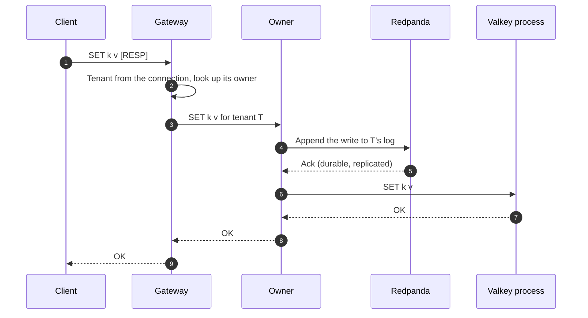
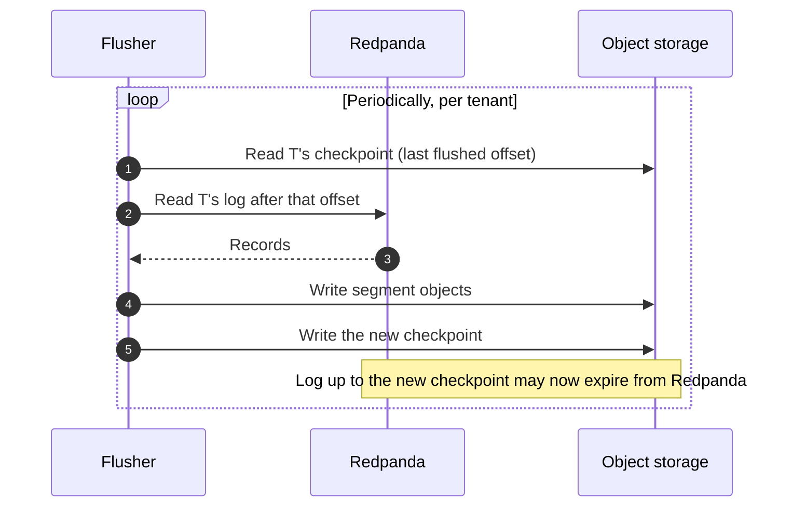
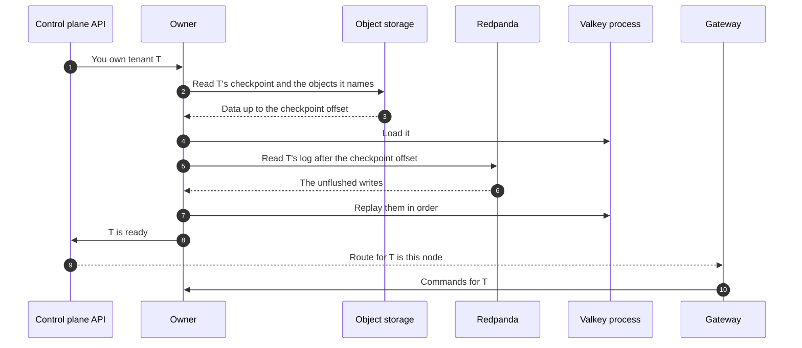

# Dynamic flows

How the containers in [02-containers.md](02-containers.md) work together over time.

## A write

The write is durable at step 5, before Valkey sees it. The client gets `OK` only after both the
log and Valkey have it. A read skips steps 4 and 5.

## A flush

After step 5, object storage alone can rebuild the tenant up to the new checkpoint.

## A data node takes a tenant

This is the same flow for a new node, a tenant moving between nodes, and recovery after a crash.

Steps 2 to 4 use the source of truth; steps 5 to 7 add the writes that have not been flushed yet.
Together they bring Valkey to exactly the state of the log, with no data kept on the node itself.
